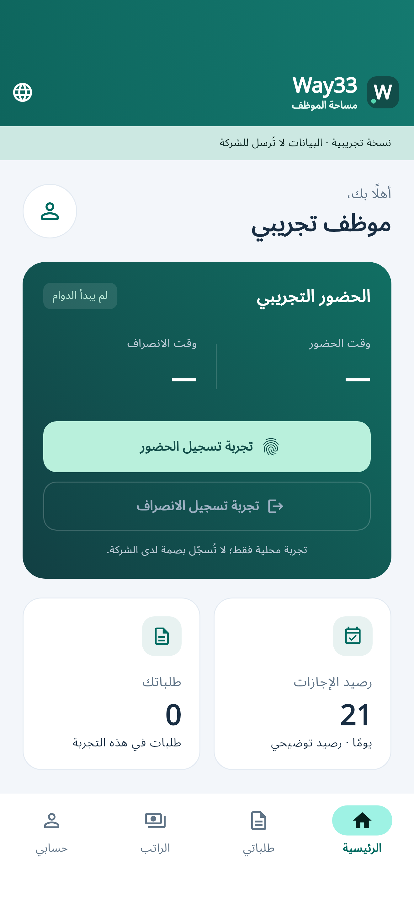
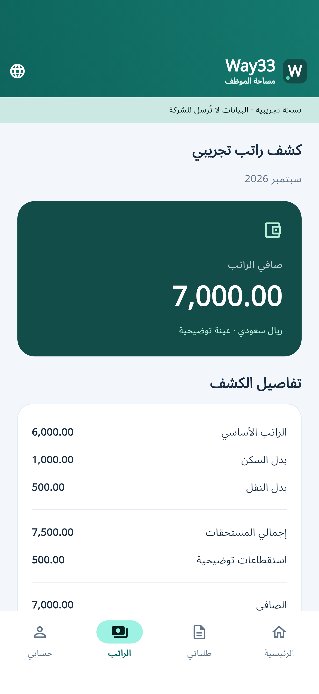

# Way33 Mobile

Flutter mobile app for Way ERP (Android, iOS, and Huawei compatibility evaluation).

Employee demo: Arabic/English company selection, attendance, leave requests, a sample payslip and account/sign-out. Supports RTL, system light/dark themes and large text. All demo data is fictional, stays in memory and is cleared on sign-out.

The visual direction uses a Way33 monogram, bundled Arabic typography, clear employee-service cards and consistent navigation. Supplied reference images guide section order and navigation; their colors and exact shapes are not requirements.

 

These images are Flutter host development renders of the current demo UI. Native iPhone/iPad captures and build artifacts are linked in the verification report below.

Use Flutter 3.35.7 (Dart 3.9) or a compatible newer SDK:

```sh
flutter pub get
flutter analyze
flutter test
flutter run --dart-define=DEMO_MODE=true
```

Android and iOS project files were generated with the official Flutter tool. GitHub Actions formats, analyzes and tests the app, builds an Android debug demo APK, and builds an unsigned iOS release archive with Xcode 26. Separate iPhone/iPad jobs run the employee flow and capture native screenshots; host widget previews are labeled separately. See [verified results and download links](UPLOAD_STATUS.md) and [Apple preparation](docs/APPLE_READINESS.md).

Live ERP login and data synchronization are not implemented. Entering a company domain only validates its format; the app does not collect passwords or verify company connectivity. `DEMO_MODE=false` hides demo entry and does not enable live login. `API_BASE_URL` currently only supplies the initial company-origin form value. See [upload status](UPLOAD_STATUS.md) for validation details and remaining integration work.

Apple distribution is intended for TestFlight, then the App Store. Developer enrollment is pending. Signing, final application IDs, approved launcher artwork, public privacy/support pages, live ERP integration and physical-device testing remain required before submission. Huawei compatibility has not been evaluated.

Development in progress. Do not commit secrets or customer data.
